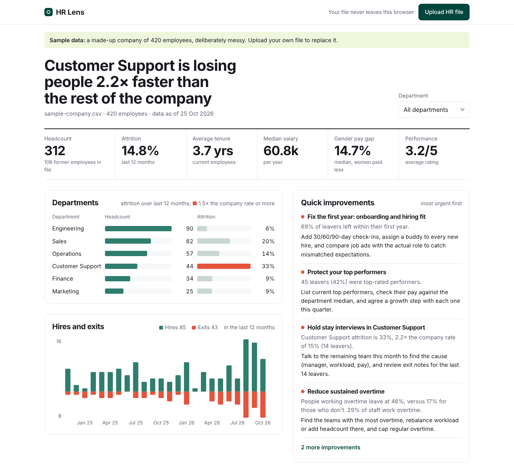

# HR Lens

**Upload your company's HR file and get a cleaned dataset, a BI dashboard and a prioritised list of improvements in seconds, in the browser, with no BI software and no data leaving your computer.**

[](https://github.com/Harigovindbn/hr-lens/actions/workflows/ci.yml)



## The business problem

Most HR teams keep their people data in spreadsheets exported from an HR system. Turning that into insight usually means:

1. cleaning the export by hand (duplicates, "Sales" vs "SALES", three date formats in one column),
2. building a Power BI or Tableau report, which needs a licence, a specialist, and a refresh process, and
3. working out from the charts what to actually do.

Small and mid-sized companies often stop at step 1. HR Lens does all three in one page that anyone in HR can use.

## What it does

| Step | What happens |
| --- | --- |
| **1. HR uploads the data** | Drop a CSV or Excel file (the sheet with the most rows is used). Nothing is uploaded to a server; everything runs in the browser. |
| **2. Classify** | Each column is recognised as an HR field (department, hire date, salary, status, rating and 17 others) from its name and its values. Names like `Dept`, `Date of Joining`, `MonthlyIncome` or `Attrition` are understood. Wrong guesses can be fixed in one click. |
| **3. Clean** | Trims spaces, removes duplicate rows and repeated employee IDs, merges spelling variants (`sales`, `SALES ` → `Sales`), reads mixed date formats (ISO, dd/mm/yyyy, `3 Jan 2020`, Excel serial numbers), strips currency symbols and `52k`-style numbers, and sets aside impossible values (negative salary, exit before hire). Every fix is listed. |
| **4. Dashboard** | Only the charts the file can support: headcount, attrition, tenure, pay, pay gap, performance, engagement, absence, hires vs exits, exit reasons, gender and age mix. Filter by department to see its job titles. |
| **5. Quick improvements** | Up to six data-backed actions, most urgent first, each with the evidence and a concrete next step. Example: *"Customer Support attrition is 33%, 2.2× the company rate of 15%. Talk to the remaining team this month…"* |
| **6. How to grow** | Longer-term recommendations: hiring plan, career paths, training investment, succession, salary bands, engagement tracking, and which data to collect next. |

Try it with [`sample/sample-company.csv`](sample/sample-company.csv), a made-up, deliberately messy company of 420 employees. The app opens with it loaded.

## How the advice is generated

Recommendations are transparent rules, not a black box. Each fires only when the data supports it, and the thresholds live in one object (`RULES` in `engine.js`) so a company can tune them.

| Recommendation | Fires when |
| --- | --- |
| Stay interviews in a department | Its attrition is ≥ 1.5× the company rate, with at least 3 leavers |
| Fix the first year | ≥ 30% of leavers left within their first year |
| Protect top performers | ≥ 20% of leavers were top-rated (top 20% of the rating scale) |
| Review underpaid high performers | A top-rated employee is paid ≥ 10% below their department median |
| Pay equity check | Median gender pay gap ≥ 5% (at least 5 people of each gender) |
| Reduce overtime | People on overtime leave at ≥ 1.5× the rate of those who aren't |
| Act on low engagement | ≥ 25% give a score in the bottom 40% of the scale |
| Unblock promotions | ≥ 40% have gone 3+ years without a promotion |
| Look into absence | A department averages ≥ 1.5× the company's absence days |
| Split oversized teams | A manager has more than 12 direct reports |
| Fill gaps in HR records | A field is blank for ≥ 10% of employees |

Attrition uses the standard formula, leavers in the last 12 months ÷ average headcount over the period, when exit dates exist. Otherwise it is leavers ÷ all records, and the dashboard says which basis it used. These thresholds are rules of thumb for starting a conversation, not industry benchmarks.

## Design decisions

- **Privacy first.** HR data is sensitive, so there is no backend. The file is parsed and analysed in the browser, which also means there is nothing to host but static files.
- **Only show what's needed.** A chart appears only if the file has the data for it, and the first screen answers "what's wrong and what do we do" before any detail.
- **The analyst can override the machine.** Column recognition is automatic but editable, and the cleaning log shows every change, so results can be trusted and checked.
- **Analysis "as of" the data.** Time-based figures use the latest date in the file, so an export from last quarter is analysed as of last quarter.

## Run it

It is a static site with no build step:

```bash
npx serve .          # then open http://localhost:3000
```

Or publish with **GitHub Pages** (Settings → Pages → Deploy from branch → `main` / root).

Tests (Node 18+):

```bash
npm test
```

The tests cover column recognition (including the public IBM HR Analytics attrition dataset's column names, and look-alike columns that must be ignored), cleaning of duplicates, spelling variants, currencies and mixed date formats, attrition maths, minimal files, and the recommendation rules.

## Project structure

```
index.html     page layout and styles (minimal light theme)
app.js         upload, rendering, charts, column re-mapping, export
engine.js      parse -> classify -> clean -> analyse -> recommend (pure functions, no DOM)
tests/         Node tests for the engine
sample/        messy sample company file
```

## Limitations

- Pay is shown in the file's own currency without a symbol; mixed currencies in one file are not converted.
- Gender analysis covers the male and female categories; other values are counted in the mix but not in the pay-gap figure.
- Very large files (hundreds of thousands of rows) work but are limited by the browser's memory.

## How this was built

Built with AI assistance (Claude) for code generation and drafting. I defined the business problem, requirements, rules and analysis approach, and reviewed and validated all outputs.

## Author

**Hari** · MSc in Artificial Intelligence · aspiring Business Analyst
[GitHub](https://github.com/Harigovindbn) · [LinkedIn](https://www.linkedin.com/in/harigovind-b-nair-7b99b0373/)
